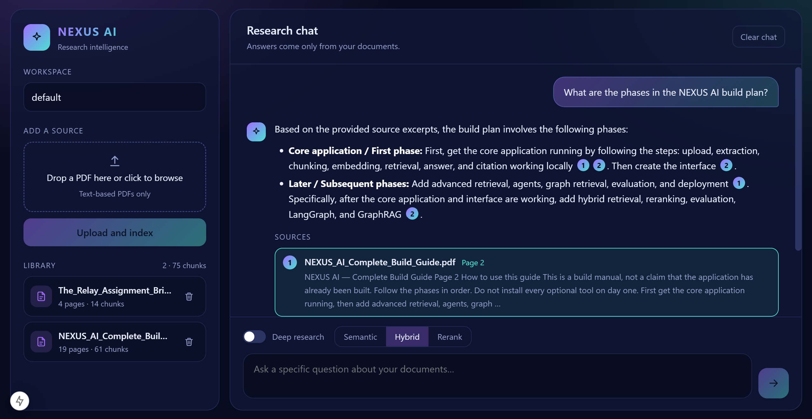
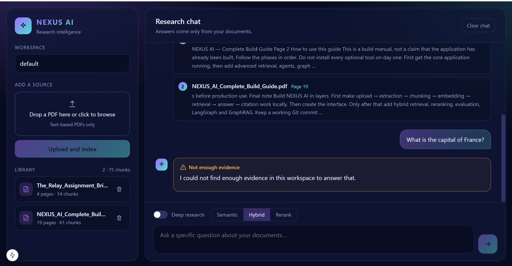

# NEXUS AI

Evidence-linked research workspace: upload PDFs, ask questions, get answers with page citations.
Built following *NEXUS AI: Complete Build Guide*.

## Live demo

**Try it here: https://nexus-ai-three-sandy.vercel.app**

This is a free demo, so please keep these in mind:
- Each browser gets its own private workspace. There are no user accounts or login.
- Uploaded files are temporary and may be cleared whenever the server restarts.
- The backend sleeps when idle, so the first visit can take up to a minute.
- Limits: 5 documents per workspace, 10 MB and 80 pages per PDF.
- Please don't upload confidential documents.

Stack: Next.js on Vercel, FastAPI on Render, Qdrant, Gemini.

## Status
| Phase | Feature | State |
|---|---|---|
| 0 | Project setup, config | Implemented |
| 1 | PDF ingestion with page metadata | Implemented |
| 2 | Embeddings + Qdrant (local) search | Implemented |
| 3 | Grounded answers, citation validation, abstention | Implemented |
| 4 | Next.js UI, document list and delete | Implemented |
| 5 | Hybrid search (BM25 + vectors, RRF), cross-encoder reranking, eval script | Implemented, run your own evaluation |
| 6 | LangGraph research workflow (plan, research, analyse, verify, write) | Implemented, bounded to 1 revision |
| 7 | GraphRAG (Neo4j) | Not built, needs a real relationship use case |
| 8 | Docker files, README, hosted demo (Render + Vercel) | Implemented. Auth: not built |

## Run locally (Windows PowerShell)
Backend:
```powershell
cd backend
py -3.12 -m venv .venv
.\.venv\Scripts\Activate.ps1
pip install -r requirements.txt
copy .env.example .env      # then put your Gemini key in .env
uvicorn app.main:app --reload
```
Check http://127.0.0.1:8000/health and http://127.0.0.1:8000/docs.

Frontend (new terminal):
```powershell
cd frontend
copy .env.local.example .env.local
npm install
npm run dev
```
Open http://localhost:3000.

## Phase 5: compare retrieval modes
1. Upload your PDFs, then copy `backend/eval/questions.example.json` to `questions.json` and write 30 to 50 real questions (expected file, page, and some should-abstain ones).
2. From `backend/`: `python -m eval.run_eval --file eval/questions.json --k 5`
3. The table compares semantic, hybrid and hybrid_rerank on hit@k, abstention and latency. Report only numbers you actually measured.

## Phase 6: research workflow
Tick "Deep research" in the UI, or `POST /api/research {"question": "...", "workspace_id": "default"}`.
It plans sub-questions, retrieves evidence, drafts notes, fact-checks them, revises once, and flags anything still unverified.

## Docker (local demo)
```powershell
docker compose up --build
```

## Tests
```powershell
cd backend
pytest -q
```

## Smoke test (guide section 8)
1. Upload a text-based PDF. Chunks indexed should be above zero.
2. Ask something the PDF clearly answers. You should get an answer with `[S1]` markers and source cards.
3. Ask something it does not cover. You should get the "not enough evidence" message.
4. Upload a second PDF to the same workspace and ask a question that needs both.

## Known limitations
- No user accounts: anyone who can reach the API can read every workspace. Do not deploy publicly before adding auth.
- Tests use a fake embedder and fake LLM. Real answer quality depends on your documents: measure it with the eval script.
- Scanned PDFs are rejected (no OCR yet).
- `MIN_SCORE` is a starting value. Tune it on your own question set.

## Screenshots



## Evaluation
I wrote 11 questions on one PDF (8 answerable, 3 that should be refused) and measured whether the correct page appears in the top k results.

| Mode | hit@1 | hit@3 | hit@5 | Correct refusals | Avg latency |
|---|---|---|---|---|---|
| Semantic (vectors) | 3/8 | 6/8 | 8/8 | 3/3 | about 10 ms |
| Hybrid (BM25 + vectors, RRF) | 6/8 | 8/8 | 8/8 | 3/3 | about 10-16 ms |
| Hybrid + cross-encoder rerank | 8/8 | 8/8 | 8/8 | 3/3 | about 0.7-1 s |

Each step improves ranking when only the top results count. Reranking costs about 1 second per query. The set is small and covers one document, so results are indicative, not conclusive.

## Not built yet
Login and user accounts, hosted deployment, GraphRAG.

## Evaluation: live demo setup (Gemini embeddings, no reranker)
Same 11 questions (8 answerable, 3 should-refuse), refusal threshold 0.57, measured on one PDF.

| Mode | hit@1 | hit@3 | Correct refusals | Avg latency |
|---|---|---|---|---|
| Semantic | 6/8 | 7/8 | 3/3 | ~0.4 s |
| Hybrid (BM25 + vectors, RRF) | 7/8 | 8/8 | 3/3 | ~0.4 s |
| Hybrid + cross-encoder rerank (local only) | 8/8 | 8/8 | 3/3 | ~1.7 s |

Switching from the local MiniLM embedding model to Gemini embeddings raised semantic hit@1 from 3/8 to 6/8 on this set. The cross-encoder needs PyTorch, which does not fit on a 512 MB free host, so the live site runs Hybrid. The set is small, so differences of one question are not conclusive.
